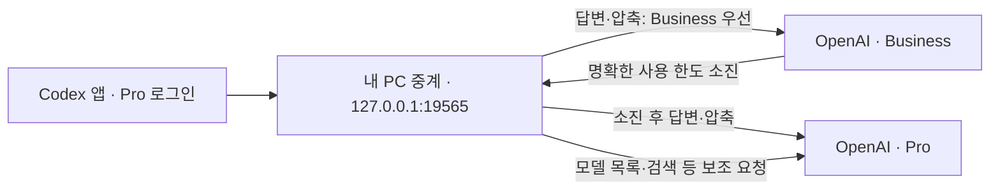

# Codex Account Relay

Codex Windows 앱에 **Pro로 로그인한 상태와 기존 대화를 유지하면서, 모델 요청에 Business 계정을 먼저 사용하는** 개인용 Windows 트레이 앱입니다. Business 한도가 소진되면 Pro로 자동 전환합니다.

## 주요 기능

- Business 우선 / Pro만 사용 / 기본 연결 복구.
- 한도 소진·인증 만료 시 Pro 전환, Business 한도 복구 후 재시도.
- 두 계정의 남은 사용량, 한도 복구 시각, 마지막 조회 시각 표시.
- `사용한도 초기화 (횟수)` 팝업에서 초기화권 만료일·남은 기간 조회와 수동 사용.
- 상세 정보가 있으면 **만료가 가장 빠른 초기화권**부터 사용. 실행 전 사용자 확인과 중복 소모 방지.
- 모델 요청과 모델 목록·검색 등의 보조 요청을 분리해서 표시.
- 내장 Codex 엔진 변경 감지, 호환성 검사, 중계 프로세스 복구.
- 응답 중 설치 보류, 정상 종료 시 이미 받은 응답 스트림 완료 대기.

각 요청에는 선택된 계정의 권한과 한도가 적용됩니다. 구독 통합이나 Gemini 연결은 현재 제공하지 않습니다.

## 어떻게 중계하나요?



1. Codex 요청 주소를 로컬 중계로 설정합니다. 앱의 로그인과 대화 데이터는 바꾸지 않습니다.
2. 답변·문맥 압축 요청의 인증 토큰과 작업공간 식별자를 Business 것으로 바꾸어 `https://chatgpt.com`에 전달합니다. 요청 본문은 그대로 전송합니다.
3. Business에서 `429 usage_limit_reached`를 받으면 해당 요청을 Pro로 한 번 전환합니다. 소진 상태를 저장해 이후 요청에는 Business를 반복 호출하지 않습니다.
4. 서버가 알려준 복구 시각이 지나면 다음 요청부터 Business를 재시도합니다. 시각이 없으면 15분 후 재시도합니다.
5. 응답은 HTTP/SSE 스트림으로 전달합니다. 이미 시작된 스트림이 끊겼을 때 중계가 다른 계정으로 재전송하지 않습니다.

Business 인증 갱신 실패나 명확한 `401` 거절도 Pro로 처리하고 재로그인 상태를 표시합니다. `403` 정책 거절과 일반 통신 오류는 계정 전환으로 우회하지 않습니다.

Pro만 사용하는 상태에서도 중계가 켜져 있으면 로컬 중계를 거칩니다. **기본 연결 복구 후 Codex를 다시 시작**해야 직접 연결로 돌아갑니다. 외부 중계 서버를 운영하거나 이용하지 않습니다.

## 처음부터 사용하기

### 1. 준비

- Windows 10/11 x64, **Node.js 24 이상**.
- Codex Windows 앱에 **개인 Pro 계정으로 로그인**.
- 별도의 Business 계정 또는 Business 작업공간.
- Windows 기본 .NET Framework C# 컴파일러로 트레이를 빌드합니다. 별도 npm 패키지는 필요 없습니다.

현재 `%USERPROFILE%\.codex\auth.json`의 ChatGPT 로그인 정보를 읽습니다. API 키 로그인이나 Business로 로그인한 Codex 앱은 이 구성의 대상이 아닙니다.

### 2. 다운로드

```powershell
git clone https://github.com/friedSaewoo/codex-account-relay.git
cd codex-account-relay
node --version
```

Git이 없다면 GitHub **Code → Download ZIP**으로 받아 압축을 풀고 그 폴더에서 PowerShell을 엽니다.

### 3. Business 등록

```powershell
node src/cli.mjs login-business
```

브라우저에서 **Business 계정과 Business 작업공간**을 선택하고 로그인합니다. 별도의 임시 프로필을 사용하므로 Codex 앱의 Pro 로그인은 유지됩니다. 잘못 선택한 개인 계정은 Business로 등록하지 않습니다. 브라우저 로그인 대신 기기 인증이 필요하면 다음 명령을 사용합니다.

```powershell
node src/cli.mjs login-business --device
```

### 4. 설치

```powershell
powershell.exe -NoProfile -ExecutionPolicy Bypass -File .\install.ps1
```

현재 사용자 폴더에 설치하고 바탕화면에 **Codex Account Relay** 바로가기를 만듭니다. 관리자 권한은 필요 없습니다. 실행 정책 옵션은 이 PowerShell 실행에만 적용됩니다.

Windows 로그인 시 자동 시작하려면 다음 옵션을 추가합니다. 기본 설치는 자동 시작을 등록하지 않습니다.

```powershell
powershell.exe -NoProfile -ExecutionPolicy Bypass -File .\install.ps1 -RegisterWindowsStartup
```

### 5. 연결 켜기

1. 바탕화면의 **Codex Account Relay**를 엽니다.
2. **Business 우선**을 선택합니다.
3. 호환성 검사 완료와 Business 사용 상태를 확인합니다. 첫 검사·엔진 변경 후 검사에는 계정별로 짧은 모델 요청이 들어갑니다.
4. Codex를 완전히 종료했다가 다시 엽니다. 로그인은 Pro로 유지합니다.
5. 기존 대화에서 작업을 계속합니다. **최근 모델**과 **실제 모델 요청**에 전송 계정이 표시됩니다.

매일 사용하는 순서는 **중계 실행 → Codex 실행**입니다. 자동 시작을 등록했다면 중계가 이미 실행 중인지 확인하면 됩니다. Codex와 함께 시작·종료하는 연동은 현재 제공하지 않습니다.

## 사용량과 초기화권

트레이 아이콘을 더블클릭하거나 바탕화면 바로가기를 열면 상태 창이 표시됩니다.
**트레이 아이콘을 우클릭하면 Business·Pro의 남은 한도와 조회 시각을 바로 볼 수 있습니다.** 계정 행을 누르면 상세 상태 창을 엽니다. 우클릭 자체는 서버 조회나 모델 요청을 추가하지 않으며, 오래되거나 실패한 조회 값에는 표시를 붙입니다.

| 표시·버튼 | 의미 |
| --- | --- |
| 5시간 / 주간 · % | 계정의 남은 사용량 비율 |
| 초기화 날짜·시각 | 서버가 알려준 사용 한도 복구 시각 |
| 조회 날짜·시각 | 마지막 조회 시각 |
| 사용량 새로고침 | 두 계정 정보를 다시 조회. 수동 조회 간격은 최소 30초 |
| 사용한도 초기화 (3) | 초기화권이 3회 남았다는 뜻 |
| 실제 모델 요청 | 답변·압축 요청의 전송 시도 횟수. 사용 토큰이나 잔여 한도와 다름 |
| 보조 요청: Pro | 모델 목록·검색 등. Business 우선이어도 발생할 수 있음 |

사용량은 약 5분 간격으로 조회하며 다른 기기 사용량도 반영될 수 있는 **계정 전체 값**입니다. 서버가 제공하지 않은 정보는 0으로 표시하지 않습니다. 요청 횟수는 중계 재시작 시 초기화됩니다.

초기화권 팝업에서 **초기화 1회 사용 → 확인 창의 예** 순서로 사용합니다. 상세 정보가 있으면 만료가 가장 빠른 권을 지정합니다. 최신 발급 순서가 아닙니다. 상세 권 목록이 없으면 서버의 기본 선택을 사용합니다. 사용 결과가 불확실하면 **결과 확인**으로 저장된 같은 요청 번호를 재확인합니다. 초기화권은 자동으로 사용하지 않습니다.

## Your dot와 모델

Pro 로그인과 PC 연결을 유지합니다. 검증 환경에서는 중계 활성화 전후에 dot의 PC 파일 읽기·쓰기·재읽기가 성공했습니다. dot의 **클라우드 모델 호출 자체**는 이 중계로 라우팅하지 않습니다. PC 작업 권한은 기존 Codex 권한을 따릅니다.

dot의 컴퓨터 연결은 [공식 연결 안내](https://learn.chatgpt.com/docs/dots/computers-and-apps)를 따르세요. 이 앱이 dot에 추가 계정을 등록하는 것은 아닙니다.

Codex에서 선택한 모델명을 그대로 전달합니다. 각 계정에 모델 접근 권한이 있어야 합니다. Astra의 Business·Pro 응답과 Business 문맥 압축 후 대화 재개를 검증했습니다. 긴 대화를 더 작은 컨텍스트의 모델로 바꾸면 압축이 오래 걸릴 수 있습니다. 이 앱이 압축 시간을 단축하거나 모델 권한을 추가하지는 않습니다.

## 끄기·업데이트·복구

- **Pro만 사용:** 중계를 유지하고 Pro로 전달합니다.
- **자동 관리 끄기 · 기본 연결 복구:** 설정을 복구합니다. 열린 Codex를 위해 서비스는 Pro 전달 상태로 유지합니다. Codex를 다시 시작하면 직접 연결됩니다.
- **종료:** 이미 받은 응답 스트림 완료 후 설정을 복구하고 중계를 종료합니다. Codex가 이전 주소를 계속 사용하면 재시작이 필요합니다.
- **업데이트:** 소스를 갱신하고 설치 명령을 다시 실행합니다. 응답 진행 중이거나 상태가 오래됐으면 보류되므로 완료 후 재실행합니다.
- **제거:** `powershell.exe -NoProfile -ExecutionPolicy Bypass -File .\uninstall.ps1`. 바로가기를 제거하고 설정을 복구합니다. 프로그램과 암호화된 Business 로그인은 보존합니다.

중계를 껐는데 `127.0.0.1:19565` 오류가 나오면 열린 Codex가 이전 주소를 기억하고 있을 수 있습니다. 중계를 다시 켜거나 아래 명령으로 설정을 복구한 뒤 Codex를 다시 시작합니다.

```powershell
node src/cli.mjs disable
```

응답 중 설치로 연결을 끊던 문제는 0.4.2에서 설치 전 확인과 정상 종료 대기로 수정했습니다. 상위 서비스·인터넷에서 발생하는 모든 스트림 오류를 없애는 기능은 아닙니다. 짧은 시험의 로컬 처리 추가 시간은 밀리초 수준이었지만 재연결, 긴 문맥 압축, 상위 서비스 상태, HTTP와 WebSocket 차이에 따라 체감 시간은 달라질 수 있습니다.

Codex 업데이트는 Codex와 내장 엔진에 적용됩니다. 이 트레이까지 자동 업데이트되지는 않습니다. 호환성이 깨지면 기본 Pro 설정 복구를 시도하고 재검사 상태를 표시합니다.

## 저장 위치와 개발

프로그램·로컬 상태는 `%USERPROFILE%\.codex-account-relay`에 보관합니다. Business 인증은 현재 Windows 사용자의 DPAPI로 암호화합니다. Pro 인증과 기존 대화 DB는 수정하지 않습니다. 감사 로그에 토큰·이메일·계정 ID·프롬프트·답변을 기록하지 않습니다. 인증·상태·검증 로그와 빌드 파일은 Git에서 제외합니다.

```powershell
powershell.exe -NoProfile -ExecutionPolicy Bypass -File .\build.ps1
node --test test/*.test.mjs
```

기본 테스트는 임시 폴더·포트를 사용하며 실제 한도나 초기화권을 소모하지 않습니다. `scripts/probe.mjs` 등의 실제 계정 검사는 별도로 실행하며 모델 요청을 사용합니다.

개인용 호환성 도구이며 OpenAI 공식 앱이나 공식 계정 통합 기능이 아닙니다. 계정 대체가 공식 보장된다고 주장하지 않습니다.

- [ChatGPT 게이트웨이 문서](https://learn.chatgpt.com/docs/enterprise/sign-in-with-chatgpt-through-a-gateway)
- [Codex app-server 문서](https://learn.chatgpt.com/docs/app-server)
- [변경 내역](CHANGELOG.md)
